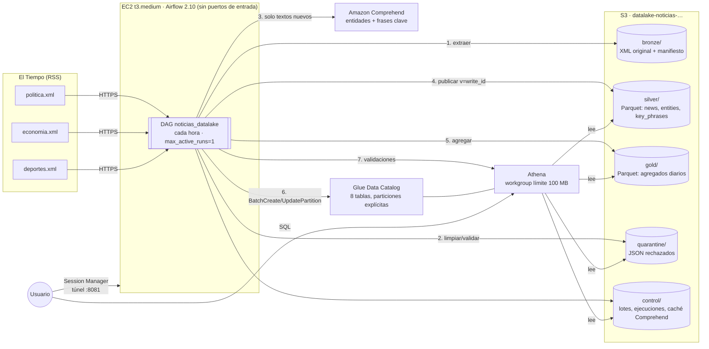

# Data Lake de noticias – documentación

Pipeline que consulta RSS de El Tiempo y guarda la respuesta original en **Bronze**. Luego la limpia,
deduplica y enriquece con **Amazon Comprehend** en **Silver**, y construye agregados en **Gold**. Todo vive en
un bucket S3, se registra en **Glue Data Catalog**, se consulta con **Athena** y lo orquesta **Airflow en
EC2**. La infraestructura está en Terraform.

## Implementaciones conservadas

Este directorio mantiene la implementación AWS original (`src/noticias`, `infra/`, `config/sources.json`, DAG `noticias_datalake`) y sus rutas de ejecución y evidencias.
La implementación independiente agregada en `fec4717` está en [`rss-local/`](rss-local/README.md): paquete `lake`, CLI `rss-lake`, fixtures locales, Docker Compose y Terraform propio.
No se fusionaron sus carpetas homónimas: difieren esquemas, particiones, publicación y catálogo. Sus comandos requieren entrar en `datalake/rss-local/`; los de este documento conservan las rutas existentes.


> 📄 **Documento de evidencias:** [`datalake/evidencias/docEVIDENCIA/EVIDENCIAS.md`](evidencias/docEVIDENCIA/EVIDENCIAS.md)
> ([ver en GitHub](https://github.com/Bostjansito/DataLAKE_WAREHOUSE/blob/main/datalake/evidencias/docEVIDENCIA/EVIDENCIAS.md))

| Documento | Contenido |
|---|---|
| [EVIDENCIAS.md](evidencias/docEVIDENCIA/EVIDENCIAS.md) | Capturas y registros de cada fase y de los 8 escenarios |
| [guias/](docs/guias/) | Una guía por fase: qué hacer en AWS y en Terraform |
| [`datalake/sql/`](sql/) | Consultas de exploración y entregables de Athena |

## 1. Arquitectura



| Zona | Formato | Partición | Mutabilidad |
|---|---|---|---|
| `bronze/source=…/ingestion_date=…/run_id=…/` | XML original + `_manifest.json` | fuente / fecha de ingesta / lote | **Inmutable**: la política IAM niega `DeleteObject` |
| `silver/<tabla>/published_date=…/v=<write_id>/` | Parquet (Snappy) | fecha de publicación UTC o `sin_fecha` | Se reescribe por partición en una carpeta nueva |
| `gold/<tabla>/published_date=…/v=<write_id>/` | Parquet (Snappy) | fecha de publicación | Ídem |
| `quarantine/news/ingestion_date=…/` | JSON Lines | fecha de ingesta | Un archivo por lote y fuente |
| `control/batches/`, `control/runs/`, `control/comprehend_cache/` | JSON | fecha de ingesta / ejecución / hash | Registro de lotes, estado de ejecuciones y caché |
| `athena-results/`, `tmp/` | – | – | Expiran a los 7 y 1 días (ciclo de vida) |

## 2. Fuentes RSS seleccionadas

| source_id | Medio | Sección | URL |
|---|---|---|---|
| `eltiempo_politica` | El Tiempo | Política | `https://www.eltiempo.com/rss/politica.xml` |
| `eltiempo_economia` | El Tiempo | Economía | `https://www.eltiempo.com/rss/economia.xml` |
| `eltiempo_deportes` | El Tiempo | Deportes | `https://www.eltiempo.com/rss/deportes.xml` |

- **Configuración:** las fuentes están en [`datalake/config/sources.json`](config/sources.json).
  Agregar una fuente no requiere cambiar el código.
- **Formato de cada feed:** 10 ítems. El `guid` es igual al enlace, y el enlace termina en el número de
  artículo (`…-3598523`). Las fechas de los ítems vienen en ISO 8601 y la del canal en RFC 822.

## 3. Diccionario de datos

Las definiciones completas (tipos y comentarios por columna) están en
[`glue.tf`](infra/terraform/glue.tf) y se ven en la consola de Glue.

### Silver

| Tabla | Grano | Columnas principales |
|---|---|---|
| `silver_news` | 1 fila por noticia (**versión vigente**) | `news_id`, `id_strategy`, `guid`, `link`, `title`, `description`, `media`, `section`, `sections[]`, `published_at_raw`, `published_at_utc`, `date_status`, `content_hash`, `analyzed_text_hash`, `language`, `enrichment_status`, `version`, `first_seen_at`, `last_updated_at`, `bronze_run_id`, `bronze_key`, `silver_run_id` |
| `silver_news_entities` | 1 fila por noticia + tipo + entidad normalizada | `news_id`, `entity_type` (PERSON/ORGANIZATION/LOCATION), `entity_text`, `entity_text_normalized`, `score` (máx.), `mentions`, `analyzed_text_hash`, `language`, `analyzed_at`, `silver_run_id` |
| `silver_news_key_phrases` | 1 fila por noticia + frase normalizada | `news_id`, `key_phrase`, `key_phrase_normalized`, `score`, `mentions`, `analyzed_text_hash`, `language`, `analyzed_at`, `silver_run_id` |

### Gold

| Tabla | Grano | Métrica |
|---|---|---|
| `gold_news_daily` | fecha + medio + sección | `news_count` = noticias distintas vigentes |
| `gold_entity_daily` | fecha + tipo + entidad normalizada | `news_count` = noticias distintas que mencionan la entidad. Las repeticiones dentro del texto **no** suman |
| `gold_key_phrases_daily` | fecha + sección + frase normalizada | `news_count` = noticias distintas con la frase |

Todas incluyen `gold_run_id` y `built_at`.

- **Sección:** es la del primer feed donde apareció la noticia, así la suma por sección es igual al total.
- **Noticias sin fecha válida:** van a `published_date='sin_fecha'`, con el motivo en `date_status`. Se
  cuentan en su propia partición y no se asignan a la fecha de ingesta, para no falsear las series diarias.

### Control y cuarentena

| Tabla | Grano | Uso |
|---|---|---|
| `control_batches` | 1 fila por lote + fuente (+ 1 por cada reprocesamiento) | URL, HTTP, SHA-256, bytes, ruta en Bronze. Conteos recibidos / válidos / rechazados / repetidos en el lote / nuevos / actualizados / sin cambios |
| `quarantine_news` | 1 fila por ítem rechazado | `reasons[]`, campos originales, `bronze_key` e `item_index` para rastrear hasta Bronze |

## 4. Reglas de calidad, identificación y actualización

| Regla | Dónde | Acción |
|---|---|---|
| Respuesta HTTP ≠ 200, vacía o XML malformado/no RSS | Extracción | No se guarda en Bronze. Se registra en `control`. Se reintenta. La ejecución queda partial o failed |
| Sin título, sin enlace o enlace no http(s) | Silver | **Cuarentena** con motivo; el resto del lote continúa |
| Fecha faltante, ilegible o futura | Silver | Se conserva en `sin_fecha` con `date_status` |
| HTML y entidades en título/descripción | Silver | Se limpian (`clean_text`) |
| Parámetros `utm_*`, `fbclid`, fragmento y barra final | Silver | Se eliminan del enlace (`normalize_link`) |
| **Identificador** | Silver | `article_id` (número de artículo) → hash del `guid` → hash del enlace → hash título+fecha |
| Repetida en el mismo lote | Silver | Se conserva la primera (`items_duplicate_in_batch`) |
| Misma noticia en otro feed | Silver | Una sola fila; se agrega la sección a `sections` |
| Mismo `content_hash` que la vigente | Silver | `unchanged`: no se reescribe ni se enriquece |
| Contenido distinto **y** lote más reciente | Silver | `version + 1`. Solo se vuelve a enriquecer si cambió el **texto analizado** (título + descripción) |
| Lote más antiguo que la versión vigente | Silver | Se ignora: reprocesar nunca revierte una noticia |

**Validaciones finales en Athena** (todas deben ser 0, [`validate.py`](src/noticias/validate.py)):

- Ids duplicados en el conjunto vigente.
- Campos obligatorios vacíos.
- Enlaces inválidos.
- Fecha inconsistente con su partición.
- Noticias sin enriquecimiento.
- Entidades o frases sin noticia asociada.
- Descuadre Gold–Silver, por noticias y por entidades.

## 5. Incrementalidad y recuperación

- **Incremental.**
  - Cada ejecución procesa solo su lote.
  - Solo se reescriben las particiones (fechas) afectadas.
  - Comprehend solo recibe textos nuevos o cambiados, y la caché por hash evita repetir llamadas.
- **Publicación atómica.**
  1. Cada escritura va a una carpeta nueva `v=<write_id>`.
  2. Al terminar, la partición se cambia en Glue con `BatchUpdatePartition`.
  3. Un fallo antes de ese cambio deja archivos huérfanos que Athena **no ve**.
  4. Un reintento escribe otra carpeta y publica: sin duplicados ni resultados parciales (escenario 11.6a).
- **Idempotencia.**
  - El lote se identifica por la ejecución del DAG.
  - Un reintento reutiliza el lote de Bronze ya guardado, sin volver a consultar el RSS.
  - Repetir un lote deja todo `unchanged` (escenario 11.3).
- **Reprocesamiento.** El parámetro `bronze_run_id` reprocesa un lote y `rebuild` reconstruye todo desde
  Bronze. Ninguno consulta los RSS, y la caché evita el costo de Comprehend.
- **Concurrencia.** `max_active_runs=1` evita dos escrituras simultáneas sobre la misma partición.
- **Fallos de fuente.**
  - Hay 2 reintentos con espera creciente.
  - Si se agotan, la fuente queda `failed` y la ejecución **partial**, con el detalle en
    `control/runs/run_id=…/dag.json`.
  - Una fuente caída nunca se registra como "sin noticias".
- **Historial.** Las carpetas `v=` anteriores quedan en S3 como historial técnico, pero no inflan las
  métricas porque Glue solo apunta a la vigente. Como mejora, podrían borrarse con una regla de ciclo de
  vida o un paso de limpieza.

## 6. Despliegue, ejecución y eliminación

Requisitos: AWS CLI con un perfil con permisos de administrador, Terraform ≥ 1.6, `uv` (Python 3.12) y
Session Manager plugin. Detalle en [guias/00-preparacion.md](docs/guias/00-preparacion.md).

```bash
# 1. Infraestructura (bucket, IAM, Glue, Athena, EC2 + Airflow, código en S3)
cd datalake/infra/terraform
cp terraform.tfvars.example terraform.tfvars        # ajustar región/nombres si hace falta
terraform init && terraform apply
../scripts/wait_bootstrap.sh                         # ~2 min: instala Airflow y arranca los servicios
cd ../../..                                         # volver a la raíz del repositorio

# 2. Ejecución: el DAG corre cada hora solo. Para una ejecución inmediata o un escenario:
datalake/infra/scripts/dag_trigger.sh '{}'                                   # extraer y procesar
datalake/infra/scripts/dag_trigger.sh '{"bronze_run_id": "20261105T020000Z"}'  # reprocesar un lote
datalake/infra/scripts/dag_trigger.sh '{"rebuild": true}'                    # reconstruir desde Bronze

# 3. Interfaz de Airflow (sin puertos abiertos)
datalake/infra/scripts/airflow_tunnel.sh             # http://localhost:8081, usuario admin
aws ssm get-parameter --name /datalake-noticias/lab/airflow/admin-password --with-decryption \
  --query Parameter.Value --output text

# 4. Publicar cambios de código sin recrear la instancia
terraform -chdir=datalake/infra/terraform apply -target=aws_s3_object.datalake_code
datalake/infra/scripts/ssm_run.sh /opt/datalake/deploy.sh

# 5. Ejecución local, sin Airflow
# Comandos alternativos; ejecutar uno por vez:
datalake/scripts/run_local.sh test
datalake/scripts/run_local.sh extract
datalake/scripts/run_local.sh silver --run-id X
datalake/scripts/run_local.sh gold --all
datalake/scripts/run_local.sh validate

# 6. Eliminación
terraform -chdir=datalake/infra/terraform destroy -target=aws_instance.airflow
terraform -chdir=datalake/infra/terraform destroy    # force_destroy=true vacía y borra el bucket
```

## 7. Estimación de costos (us-east-1)

| Servicio | Uso en el laboratorio | Costo estimado |
|---|---|---|
| EC2 `t3.medium` + IPv4 pública | USD 0,0466/h mientras está encendida | ~USD 0,47 por 10 h |
| EBS gp3 20 GB | USD 1,60/mes, prorrateado | ~USD 0,02 por día |
| Comprehend (entidades + frases) | 46 noticias, ~22.000 caracteres analizados una sola vez | ~USD 0,05 |
| Athena | ~60 consultas × mínimo de 10 MB = 0,6 GB | ~USD 0,003 |
| S3 | < 5 MB y unos miles de solicitudes | < USD 0,01 |
| Glue Data Catalog | < 1.000 objetos y solicitudes (capa gratuita: 1 millón) | USD 0 |
| SSM (Session Manager, Parameter Store estándar) | – | USD 0 |
| **Total del laboratorio** | | **< USD 1** |

**En operación continua** (cada hora, 3 fuentes):

- Cada hora llegan ~3–10 noticias nuevas, unos 2.000 caracteres analizados: ~USD 0,004 de Comprehend.
- La EC2 encendida todo el mes costaría ~USD 34. Es el costo dominante, por eso se destruye o apaga al
  terminar.
- Athena no crece con el historial, porque las consultas filtran por partición.
