# Evidencias – Data Lake de noticias RSS

Documento de evidencias del taller **Arquitecturas de datos – Data Lake**. Cada captura se guarda en
`datalake/evidencias/<fase>/` y se enlaza aquí, indicando qué demuestra y a qué requisito responde.

- **Cuenta AWS:** `387512138242` · **Usuario:** `sebastian-admin` · **Región:** `us-east-1`
- **Infraestructura:** Terraform · **Orquestación:** Apache Airflow en EC2
- Las salidas de terminal (Terraform, CLI) se guardan como texto en `datalake/evidencias/<fase>/*.txt`.

**Estado:** ✅ capturada · ⏳ pendiente

---

## Índice de capturas

| # | Fase | Evidencia | Requisito | Estado |
|---|---|---|---|---|
| 0.1 | Acceso | Usuario IAM con el que se despliega | Verificación de acceso | ✅ |
| 0.2 | Acceso | Salida de `aws sts get-caller-identity` | Verificación de acceso | ✅ |
| 1.1 | Infraestructura | `terraform plan` / `apply` del bucket | Despliegue con Terraform | ✅ |
| 1.2 | Infraestructura | Bucket único con zonas bronze/silver/gold/quarantine | Un solo bucket | ✅ |
| 1.3 | Infraestructura | Bucket privado y cifrado (bloqueo de acceso público, cifrado) | Seguridad | ✅ |
| 1.4 | Infraestructura | Reglas de ciclo de vida del bucket | Minimizar costos | ✅ |
| 2.1 | IAM | Rol de la instancia EC2 con permisos mínimos | Seguridad | ✅ |
| 3.1 | Glue | Base de datos en Glue Data Catalog | 4.4 Registro con Glue | ✅ |
| 3.2 | Glue | Tablas Silver y Gold: ubicación, columnas, tipos, formato | 4.4 Registro con Glue | ✅ |
| 3.3 | Glue | Clave de partición por fecha definida en las tablas | 4.4 Registro con Glue | ✅ |
| 3.4 | Glue | Particiones registradas tras la primera carga | 4.4 Registro con Glue | ✅ |
| 4.1 | Athena | Workgroup con límite de bytes escaneados | Minimizar costos | ✅ |
| 5.1 | EC2 | Instancia EC2 de Airflow en ejecución | 4.6 Airflow en EC2 | ✅ |
| 5.2 | Airflow | Interfaz de Airflow con el DAG cargado | 4.6 Airflow en EC2 | ✅ |
| 6.1 | Bronze | Objetos `bronze/source=…/ingestion_date=…/run_id=…/` | 4.2 Bronze | ✅ |
| 6.2 | Bronze | Metadatos del lote (run_id, URL, estado HTTP, hash) | 4.2 Bronze | ✅ |
| 7.1 | Silver | Archivos Parquet de `news`, `news_entities`, `news_key_phrases` | 4.3 Silver | ✅ |
| 7.2 | Silver | Registros en cuarentena con motivo | 4.3 Silver | ✅ (11.2) |
| 7.3 | Comprehend | Resultados de entidades y frases clave con puntuaciones | 4.3 Comprehend | ✅ |
| 8.1 | Gold | Archivos Parquet de las tablas Gold y preguntas 1–3 | 4.4 Gold | ✅ |
| 9.1 | Airflow | Ejecución exitosa completa del DAG (vista Grid/Graph) | 4.6 Orquestación | ✅ |
| 9.2 | Airflow | Log de una tarea con fuente, lote y tarea | 4.6 Orquestación | ✅ |
| 10.1 | Athena | Noticias por fecha y sección | 4.4 Consumo con Athena | ✅ |
| 10.2 | Athena | Top 10 organizaciones en más noticias | 4.4 Consumo con Athena | ✅ |
| 10.3 | Athena | Presencia de una entidad entre días | 4.4 Consumo con Athena | ✅ |
| 10.4 | Athena | Frases clave más frecuentes por sección | 4.4 Consumo con Athena | ✅ |
| 10.5 | Athena | Conciliación Gold vs Silver | 4.4 Consumo con Athena | ✅ |
| 10.6 | Athena | Bytes escaneados con filtro de partición | 4.4 Comparación de escaneo | ✅ |
| 10.7 | Athena | Bytes escaneados sin filtro de partición | 4.4 Comparación de escaneo | ✅ |
| 11.1 | Escenario | Carga inicial | 4.5 | ✅ |
| 11.2 | Escenario | Registros defectuosos | 4.5 | ✅ |
| 11.3 | Escenario | Repetición de un lote exitoso | 4.5 | ✅ |
| 11.4 | Escenario | Nuevo lote incremental | 4.5 | ✅ |
| 11.5 | Escenario | Noticia con contenido modificado | 4.5 | ✅ |
| 11.6 | Escenario | Fallo controlado y reejecución | 4.5 | ✅ |
| 11.7 | Escenario | Reprocesamiento desde Bronze | 4.5 | ✅ |
| 11.8 | Escenario | Nueva partición disponible en Athena | 4.5 | ✅ |
| 12.1 | Limpieza | `terraform destroy` de la instancia EC2 (el bucket se conserva para la parte DW) | Eliminación de recursos | ✅ |

---

## 0. Acceso a AWS

### 0.1 Usuario IAM utilizado
Usuario `sebastian-admin` de la cuenta `387512138242`, con la política `AdministratorAccess`. Es la identidad
que usan el AWS CLI, el MCP de AWS y Terraform.

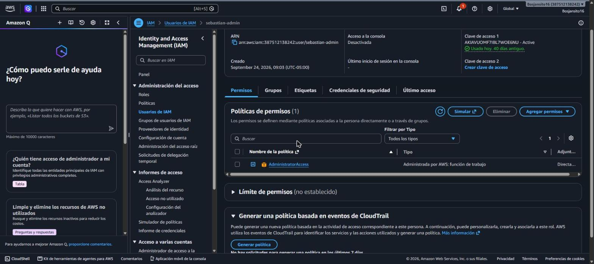

### 0.2 Identidad desde la terminal
Salida guardada en [`02-sts-get-caller-identity.txt`](../00-acceso/02-sts-get-caller-identity.txt):

```text
$ aws sts get-caller-identity   # 2026-11-04T03:39:03Z
{
    "UserId": "AIDAVUOMF7IBNVNTFUVTH",
    "Account": "387512138242",
    "Arn": "arn:aws:iam::387512138242:user/sebastian-admin"
}
```

---

## 1. Infraestructura base (Terraform)

Código: [`datalake/infra/terraform/s3.tf`](../../infra/terraform/s3.tf) · Guía: [`guias/01-bucket-s3.md`](../../docs/guias/01-bucket-s3.md)

### 1.1 Plan y aplicación de Terraform
Salidas completas: [`01-terraform-plan.txt`](../01-bucket-s3/01-terraform-plan.txt) y
[`02-terraform-apply.txt`](../01-bucket-s3/02-terraform-apply.txt).

```text
Plan: 14 to add, 0 to change, 0 to destroy.
...
Apply complete! Resources: 14 added, 0 changed, 0 destroyed.

Outputs:
data_lake_bucket = "datalake-noticias-387512138242-us-east-1"
data_lake_zones = {
  "athena-results" = "s3://datalake-noticias-387512138242-us-east-1/athena-results/"
  "bronze"         = "s3://datalake-noticias-387512138242-us-east-1/bronze/"
  "control"        = "s3://datalake-noticias-387512138242-us-east-1/control/"
  "gold"           = "s3://datalake-noticias-387512138242-us-east-1/gold/"
  "quarantine"     = "s3://datalake-noticias-387512138242-us-east-1/quarantine/"
  "silver"         = "s3://datalake-noticias-387512138242-us-east-1/silver/"
  "tmp"            = "s3://datalake-noticias-387512138242-us-east-1/tmp/"
}
```

### 1.2 Bucket único con las zonas del data lake
Un solo bucket, `datalake-noticias-387512138242-us-east-1`, con una carpeta (prefijo) por zona, como pide el taller.

| Zona | Uso |
|---|---|
| `bronze/` | Respuestas RSS originales, inmutables |
| `silver/` | Noticias limpias y enriquecidas (Parquet) |
| `gold/` | Agregados analíticos (Parquet) |
| `quarantine/` | Registros inválidos con su motivo |
| `control/` | Manifiestos y estado de cada lote |
| `athena-results/` | Resultados de consultas de Athena (expiran a los 7 días) |
| `tmp/` | Escrituras temporales antes de publicar (expiran a 1 día) |

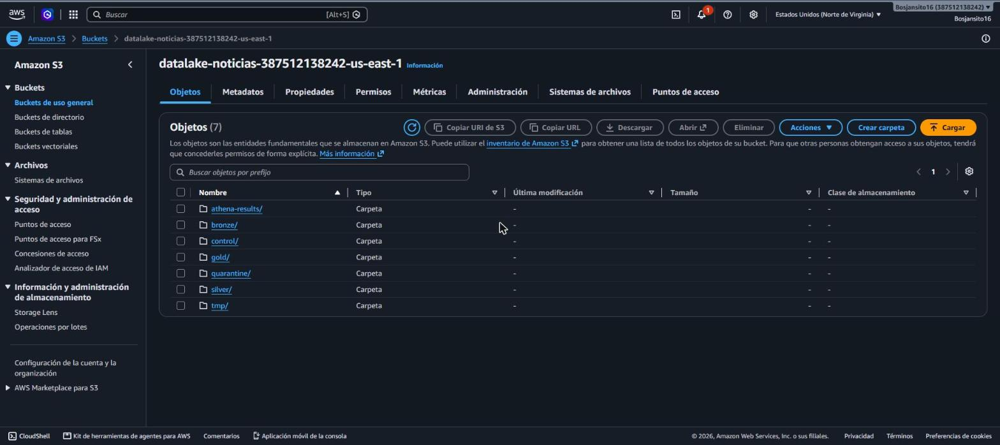

### 1.3 Bucket privado y cifrado
Bloqueo de acceso público activado:

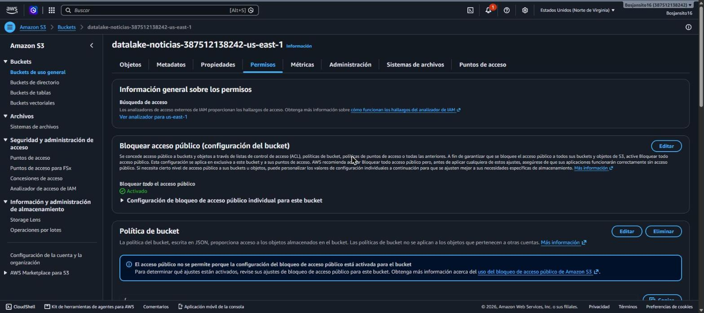

Política de bucket que rechaza cualquier conexión sin HTTPS:

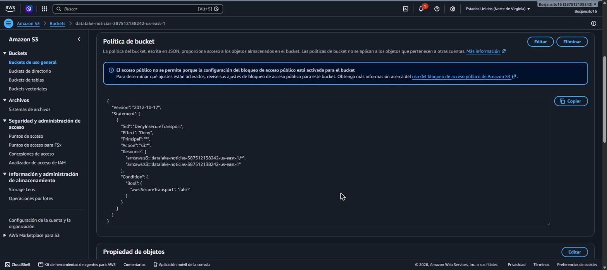

Cifrado SSE-S3 por defecto y etiquetas aplicadas por Terraform (`ManagedBy = terraform`):

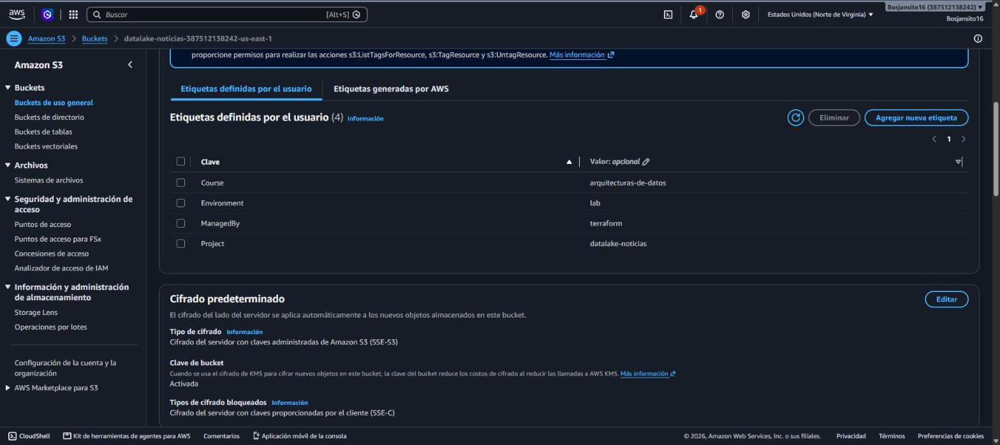

### 1.4 Ciclo de vida del bucket
Tres reglas para no pagar por datos que no se necesitan: abortar cargas multiparte incompletas
(1 día), expirar `athena-results/` (7 días) y expirar `tmp/` (1 día).

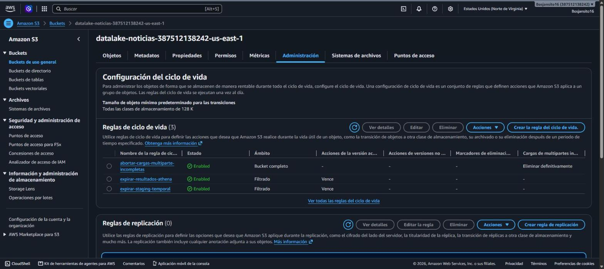

---

## 2. IAM

Código: [`datalake/infra/terraform/iam.tf`](../../infra/terraform/iam.tf) · Guía: [`guias/02-iam.md`](../../docs/guias/02-iam.md) ·
Terraform: [`plan`](../02-iam/01-terraform-plan.txt) / [`apply`](../02-iam/02-terraform-apply.txt) (5 recursos)

### 2.1 Rol de la instancia EC2
Rol `datalake-noticias-lab-airflow-ec2` con su perfil de instancia. Tiene dos políticas: la del pipeline
(administrada por el cliente) y `AmazonSSMManagedInstanceCore`, para entrar a la EC2 sin abrir el puerto 22.

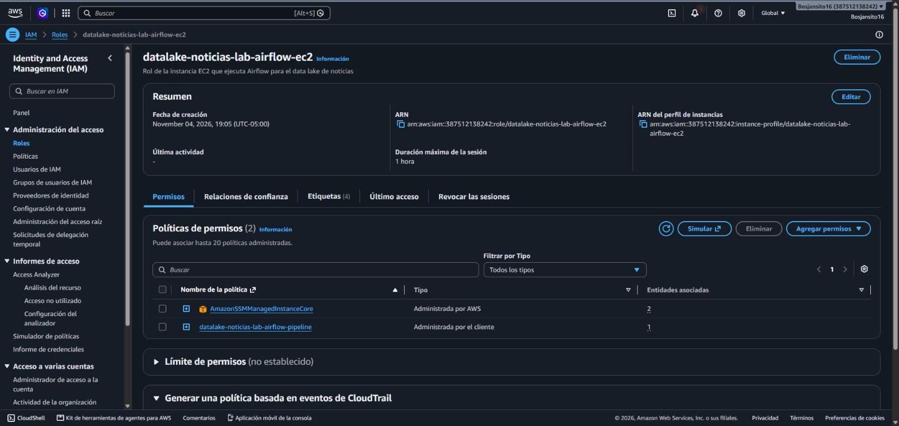

Solo el servicio EC2 puede asumir el rol:

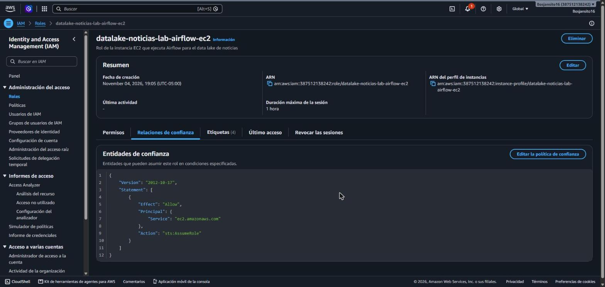

Resumen de la política del pipeline: permite solo Athena, Comprehend, Glue y S3, cada uno limitado a los
recursos del proyecto, y **niega borrar objetos de `bronze/`** para conservar los datos originales.

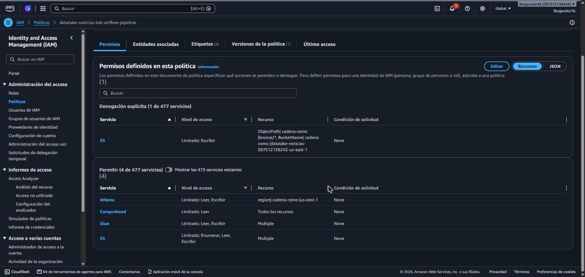

---

## 3. AWS Glue Data Catalog

Código: [`datalake/infra/terraform/glue.tf`](../../infra/terraform/glue.tf) · Guía: [`guias/03-glue.md`](../../docs/guias/03-glue.md) ·
Terraform: [`plan`](../03-glue/01-terraform-plan.txt) / [`apply`](../03-glue/02-terraform-apply.txt) (8 recursos)

### 3.1 Base de datos y 3.2 Tablas de Silver y Gold
Base `datalake_noticias_lab` con 7 tablas definidas explícitamente con Terraform, sin crawlers:
3 de Silver y 3 de Gold en Parquet, y 1 de control en JSON.

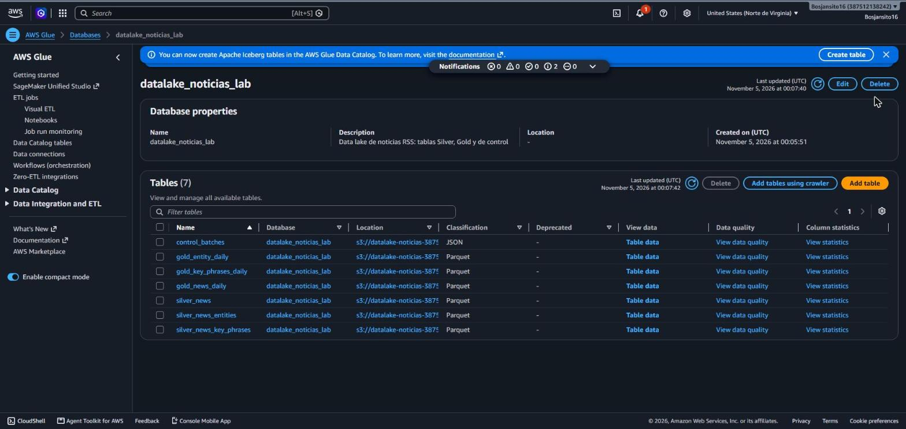

Esquema de `silver_news`: columnas, tipos y comentarios del diccionario de datos.

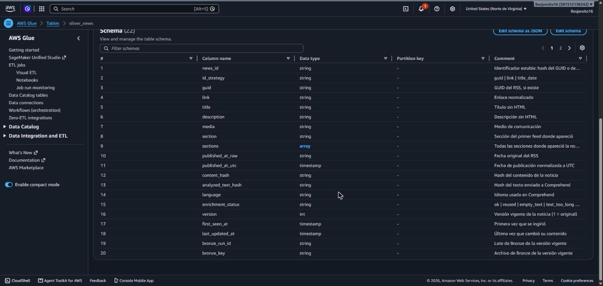

### 3.3 Ubicación, formato y clave de partición
`silver_news` apunta a `s3://…/silver/news/`, es Parquet y está particionada por `published_date`.

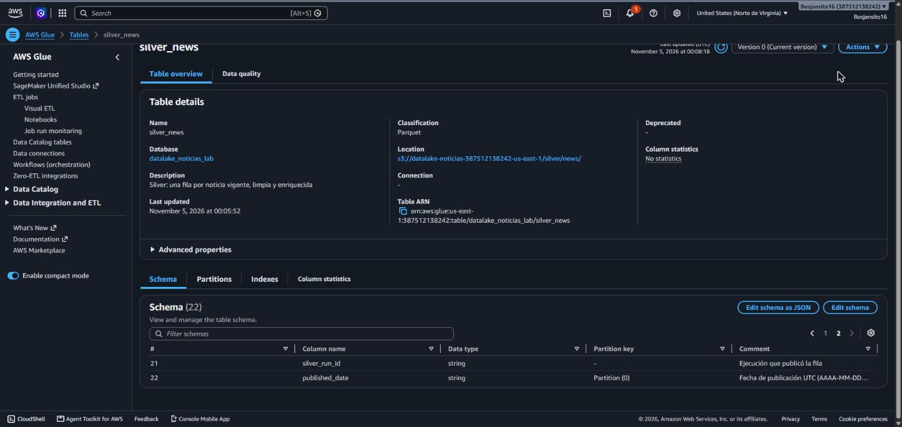

### 3.4 Particiones registradas
Después de la primera carga, el pipeline registró las particiones con `BatchCreatePartition`, sin crawler.
`silver_news` tiene las particiones `2026-11-04` y `2026-11-05`:

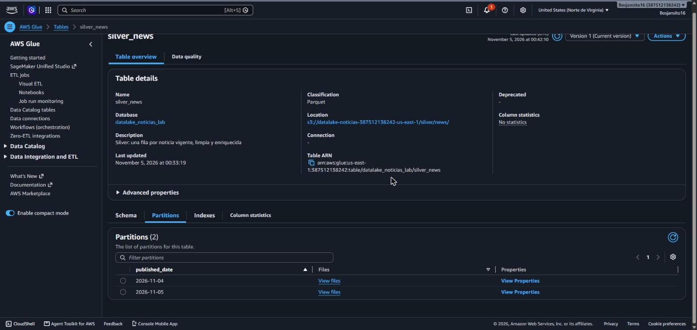

Cambio posterior de esquema, aplicado con Terraform: columna `date_status` en `silver_news`, columnas
`processed_at`/`processing_run_id` en `control_batches` y nueva tabla `quarantine_news`.
Ver [`plan`](../03-glue-v2/01-terraform-plan.txt) / [`apply`](../03-glue-v2/02-terraform-apply.txt)
(`1 to add, 2 to change, 0 to destroy`).

---

## 4. Amazon Athena

Código: [`datalake/infra/terraform/athena.tf`](../../infra/terraform/athena.tf) · Guía: [`guias/04-athena.md`](../../docs/guias/04-athena.md) ·
Terraform: [`plan`](../04-athena/01-terraform-plan.txt) / [`apply`](../04-athena/02-terraform-apply.txt) (1 recurso)

### 4.1 Workgroup con límite de escaneo
Workgroup `datalake-noticias-lab-wg`: motor v3, resultados cifrados (SSE-S3) en `athena-results/`,
configuración forzada para todos los clientes y **límite de 100 MB escaneados por consulta**.

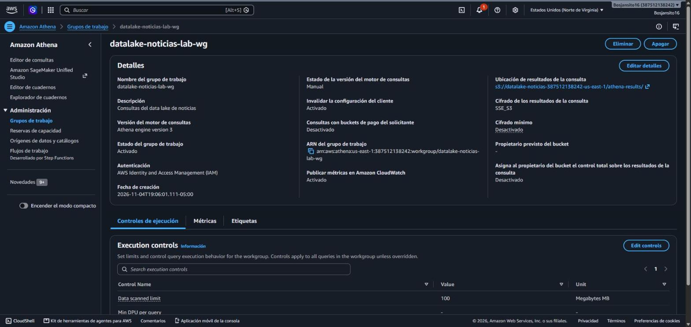

---

## 5. Airflow en EC2

Terraform: [`ec2_airflow.tf`](../../infra/terraform/ec2_airflow.tf) ·
Guía: [`guias/05-ec2-airflow.md`](../../docs/guias/05-ec2-airflow.md) ·
[`plan`](../05-ec2-airflow/01-terraform-plan.txt) / [`apply`](../05-ec2-airflow/02-terraform-apply.txt)
(`5 to add, 1 to change`) · corrección del PATH del scheduler: [`apply v2`](../05-ec2-airflow-v2/02-terraform-apply.txt)
(`1 added, 1 destroyed`, la instancia se reemplazó) · despliegues de código:
[`v1`](../05-despliegue-codigo/02-terraform-apply.txt), [`v2`](../05-despliegue-codigo-v2/02-terraform-apply.txt)

### 5.1 Instancia EC2
`t3.medium` con Amazon Linux 2023, rol `datalake-noticias-lab-airflow-ec2` e IMDSv2 obligatorio:

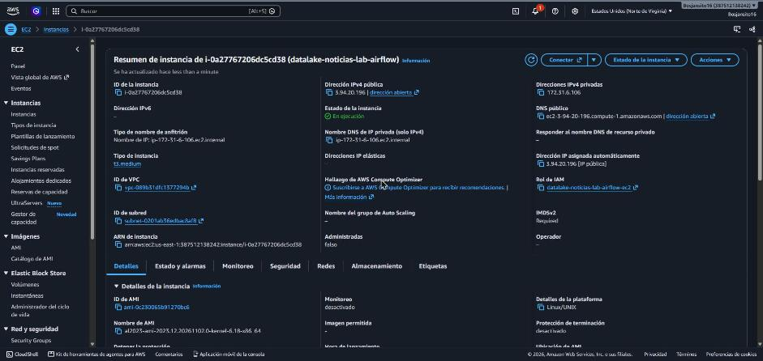

El grupo de seguridad no tiene **ninguna regla de entrada**. La interfaz de Airflow se abre con reenvío de
puertos de Session Manager, autenticado con IAM:

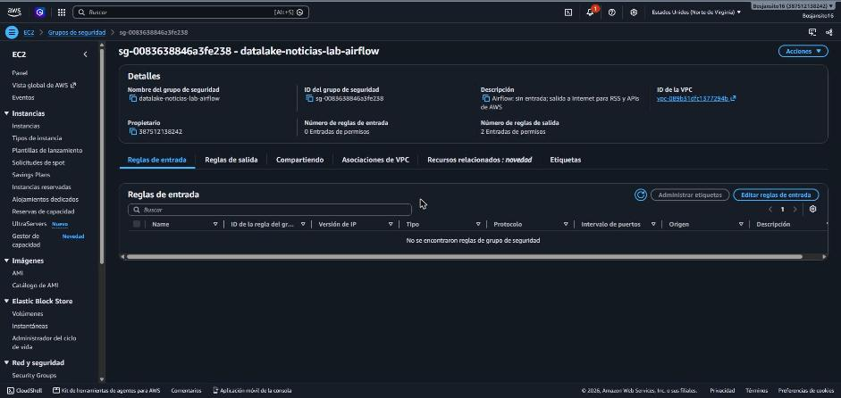

### 5.2 DAG cargado en Airflow
Interfaz de Airflow 2.10.5 abierta por el túnel de Session Manager (`http://localhost:8081`). El DAG
`noticias_datalake` está activo, con programación horaria (`0 * * * *`) y sus ejecuciones recientes en verde:

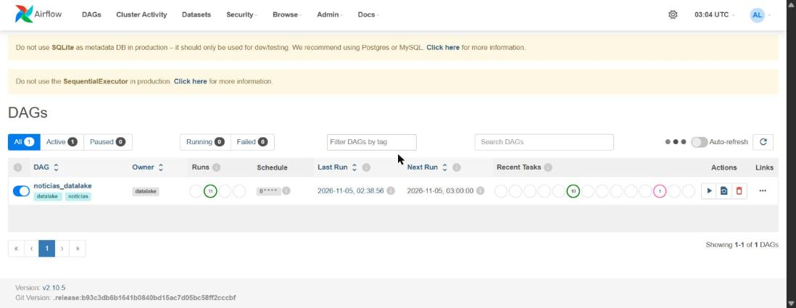

---

## 6. Capa Bronze

Código: [`datalake/src/noticias/ingest.py`](../../src/noticias/ingest.py) · Fuentes: [`datalake/config/sources.json`](../../config/sources.json) ·
Guía: [`guias/06-bronze.md`](../../docs/guias/06-bronze.md) · Log: [`01-extract.log`](../06-bronze/01-extract.log)

Primera extracción, lote `20261105T003325Z`: las 3 fuentes respondieron HTTP 200 con 10 ítems cada una y
la ejecución quedó **complete**.

```text
source=eltiempo_politica run_id=20261105T003325Z task=extract status=success http=200 items=10 bytes=13239
source=eltiempo_economia run_id=20261105T003325Z task=extract status=success http=200 items=10 bytes=13041
source=eltiempo_deportes run_id=20261105T003325Z task=extract status=success http=200 items=10 bytes=12748
run_id=20261105T003325Z task=extract status=complete ok=3 failed=0
```

### 6.1 Organización de objetos en S3
Una carpeta por fuente, y dentro de ella `ingestion_date=…/run_id=…/`:

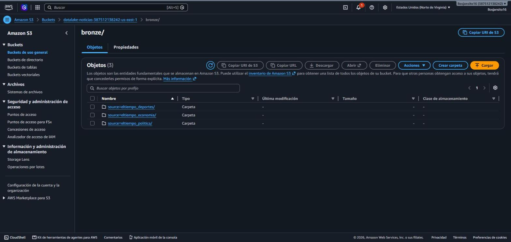

Cada lote guarda la respuesta original (`feed.xml`, sin modificar) y su manifiesto (`_manifest.json`), que se
escribe al final y marca el lote como completo:

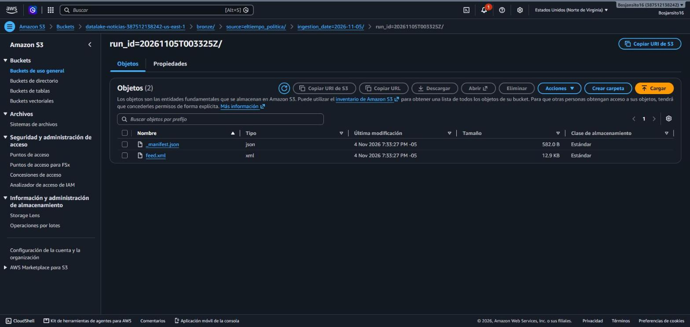

### 6.2 Metadatos del lote
Registro por lote y fuente en `control_batches`: identificador de ejecución, fuente, URL, estado HTTP,
hash SHA-256, tamaño, ubicación en S3 y fecha de ingesta UTC.

```sql
SELECT run_id, source_id, http_status, status, items_received,
       content_bytes, substr(content_hash, 1, 16) AS sha256_inicio, bronze_key, ingestion_ts
FROM control_batches
WHERE ingestion_date = '2026-11-05' AND batch_type = 'extraction'
ORDER BY source_id;
```

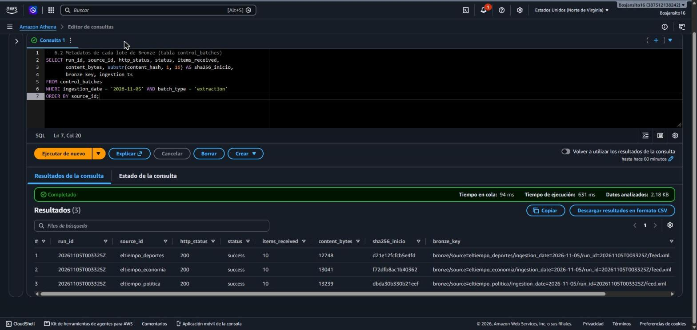

---

## 7. Capa Silver y Amazon Comprehend

Código: [`parse.py`](../../src/noticias/parse.py), [`enrich.py`](../../src/noticias/enrich.py),
[`silver.py`](../../src/noticias/silver.py) · Pruebas: [`tests/test_parse.py`](../../tests/test_parse.py) (8 pruebas OK) ·
Guía: [`guias/07-silver.md`](../../docs/guias/07-silver.md) · Logs: [`carga inicial`](../07-silver/01-silver-carga-inicial.log),
[`rebuild`](../07-silver/02-silver-rebuild-desde-bronze.log)

Procesamiento del lote `20261105T003325Z`: 30 ítems recibidos, 30 válidos, 0 rechazados, 0 duplicados,
**30 noticias nuevas**, 4 llamadas a Comprehend y 2 particiones de fecha publicadas.

```text
task=enrich analyzed=30 reused=0 skipped={} errors=0 api_calls=4 chars_sent=14690
source=eltiempo_politica task=silver received=10 valid=10 rejected=0 dup=0 new=10 updated=0 unchanged=0
task=silver mode=incremental news_current=30 changed=30 affected_dates=['2026-11-04', '2026-11-05']
```

### 7.1 Conjuntos Parquet de Silver
Tres tablas en `silver/`, una carpeta por tabla:

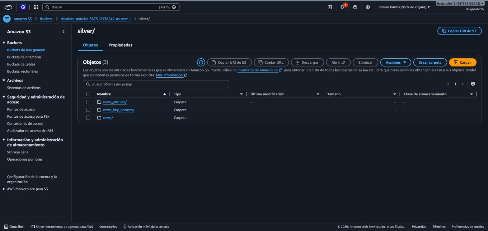

Cada partición tiene una carpeta por versión publicada (`v=<write_id>`). Glue apunta solo a la vigente, así
que una reescritura nunca deja visibles en Athena archivos parciales o duplicados:

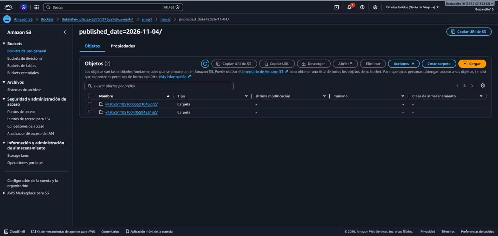

`silver_news`: texto sin HTML, identificador `eltiempo-<número de artículo>`, fecha normalizada a UTC con
su estado, versión y estado del enriquecimiento:

```sql
SELECT published_date, section, news_id, id_strategy, substr(title, 1, 55) AS titulo,
       published_at_utc, date_status, version, enrichment_status
FROM silver_news WHERE published_date = '2026-11-04'
ORDER BY section, news_id LIMIT 10;
```

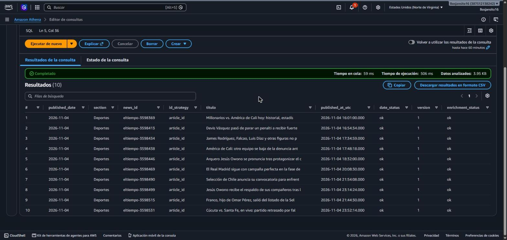

### 7.2 Cuarentena
Los feeds reales de esta carga no tenían ítems inválidos (0 rechazados). Las reglas de rechazo
(`missing_title`, `missing_link`, `invalid_link`) están cubiertas por pruebas unitarias. La evidencia en AWS se
genera en la Fase 9 con un RSS controlado con registros defectuosos (escenario 11.2).

### 7.3 Resultados de Comprehend
Entidades (persona, organización, lugar) con su puntuación de confianza, menciones, idioma, fecha de
análisis y hash del texto analizado:

```sql
SELECT n.section, e.news_id, e.entity_type, e.entity_text, round(e.score, 4) AS score,
       e.mentions, e.language, e.analyzed_at, substr(e.analyzed_text_hash, 1, 12) AS text_hash
FROM silver_news_entities e
JOIN silver_news n ON n.news_id = e.news_id AND n.published_date = e.published_date
WHERE e.published_date = '2026-11-04' AND n.section = 'Política'
ORDER BY e.news_id, e.entity_type, e.score DESC LIMIT 12;
```

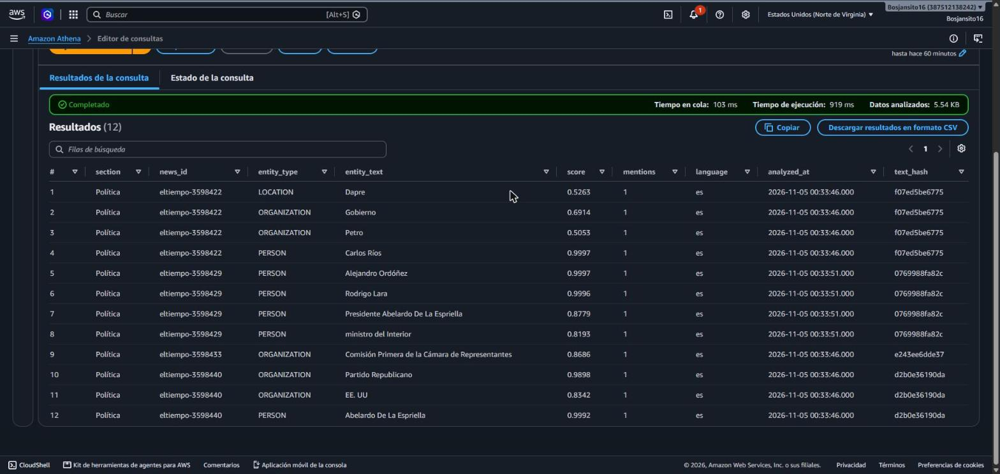

> **Limitación observada:** Comprehend clasificó "Petro" como `ORGANIZATION` y "presidente" o
> "ministro del Interior" como `PERSON`. Las entidades son detecciones automáticas: un cargo puede salir
> como persona, y las puntuaciones bajas indican menor certeza.

Frases clave distintas por noticia, con su forma normalizada para agrupar:

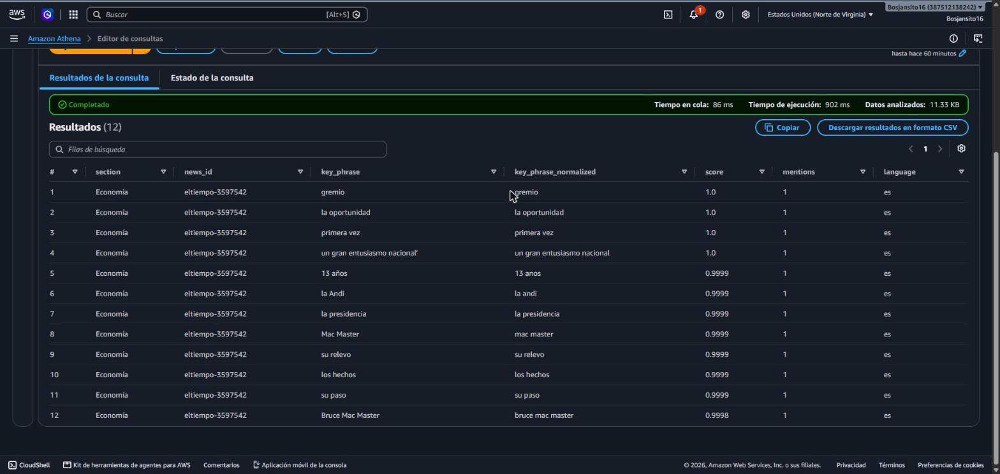

Caché de resultados en `control/comprehend_cache/` por hash del texto, para no volver a llamar a Comprehend
con textos ya analizados:

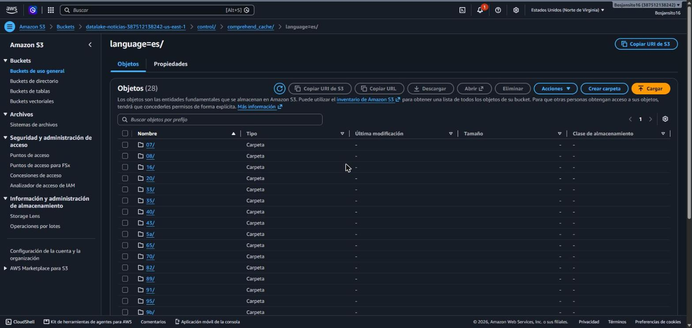

**Reconstrucción desde Bronze sin llamar de nuevo a Comprehend.** Después de corregir la normalización (la
ñ se conserva: "años" ya no queda como "anos"), Silver se reconstruyó desde Bronze. Las 30 noticias salieron
de la caché, con **0 llamadas a Comprehend** y sin consultar los RSS:

```text
task=enrich analyzed=0 reused=30 skipped={} errors=0 api_calls=0 chars_sent=0
glue table=silver_news partitions_created=0 partitions_updated=2
```

---

## 8. Capa Gold

Código: [`datalake/src/noticias/gold.py`](../../src/noticias/gold.py) · Guía: [`guias/08-gold.md`](../../docs/guias/08-gold.md) ·
Logs: [`carga inicial`](../08-gold/01-gold-carga-inicial.log), [`--all`](../08-gold/02-gold-all.log)

### 8.1 Conjuntos Parquet de Gold


**Noticias por día, medio y sección** (pregunta 1). La suma, 30, coincide con las noticias distintas de Silver:

```sql
SELECT published_date, media, section, news_count, gold_run_id, built_at
FROM gold_news_daily ORDER BY published_date, section;
```

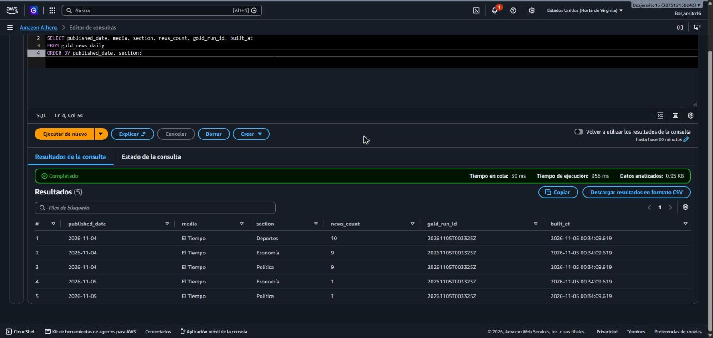

**Personas, organizaciones y lugares en más noticias distintas** (pregunta 2):

```sql
SELECT entity_type, entity_text, sum(news_count) AS noticias, count(DISTINCT published_date) AS dias
FROM gold_entity_daily
GROUP BY entity_type, entity_text
ORDER BY noticias DESC, entity_text LIMIT 12;
```

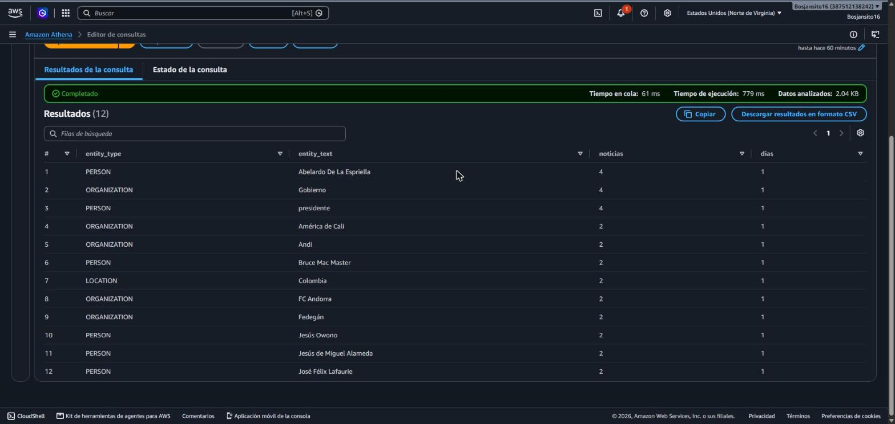

**Frases clave más frecuentes por sección** (pregunta 3):

```sql
SELECT section, key_phrase, news_count
FROM (
  SELECT section, key_phrase, sum(news_count) AS news_count,
         row_number() OVER (PARTITION BY section ORDER BY sum(news_count) DESC, key_phrase) AS rk
  FROM gold_key_phrases_daily GROUP BY section, key_phrase
)
WHERE rk <= 4 ORDER BY section, news_count DESC;
```

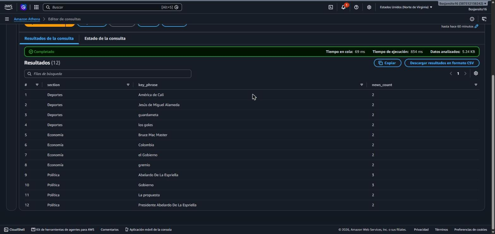

La pregunta 4 (cambio de la presencia de una entidad entre fechas) usa `gold_entity_daily` por
`published_date`. Se demuestra en la Fase 10, cuando haya varios días de datos.

---

## 9. Ejecución del DAG

DAG: [`datalake/dags/noticias_datalake.py`](../../dags/noticias_datalake.py) ·
Guía: [`guias/09-dag-escenarios.md`](../../docs/guias/09-dag-escenarios.md)

### 9.1 Ejecución completa
La primera ejecución **programada** (`scheduled__2026-11-05T00:00:00`) corrió sola al desbloquearse el DAG,
sin intervención entre etapas, y terminó en `success` en 1 minuto. Estado de las tareas de una ejecución
(extraído con `airflow tasks states-for-dag-run` por SSM):

```text
validar_configuracion       success
fuentes                     success
extraer_fuente [x3]         success
resumen_extraccion          success      -> complete
limpiar_validar_deduplicar  success
enriquecer_comprehend       success
publicar_silver             success
construir_gold              success
actualizar_glue             success
validar_athena              success
registrar_estado            success
```

<!-- CAPTURAS_AIRFLOW -->
Vista **Grid**: una columna por ejecución y una fila por tarea. Todas terminaron en `success`; los
cuadros rosados de `extraer_fuente` son las fuentes omitidas o caídas de los escenarios 11.6 y 11.7, que no
detienen el resto del DAG:

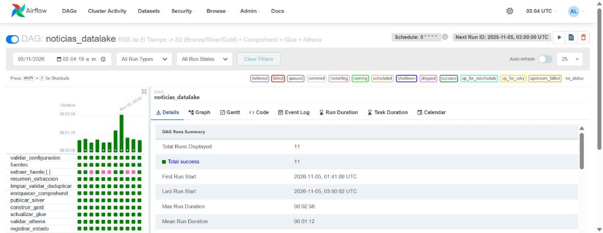

Vista **Graph** de la ejecución programada de las 02:00 UTC, con las dependencias entre etapas y
`extraer_fuente` mapeada dinámicamente sobre las 3 fuentes:

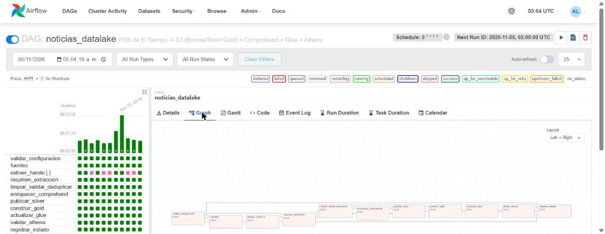

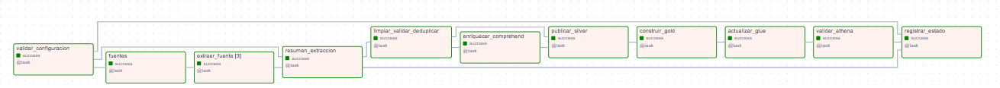

### 9.2 Logs con fuente, lote y tarea
Extracto de los logs de Airflow de `extraer_fuente` (fuente no disponible) y de `publicar_silver` (fallo controlado):
[`06b-logs-airflow-extraer-fuente.log`](../09-escenarios/06b-logs-airflow-extraer-fuente.log),
[`06a-logs-airflow-publicar-silver.log`](../09-escenarios/06a-logs-airflow-publicar-silver.log)

```text
ERROR - Failed to execute job 89 for task extraer_fuente (source=eltiempo_deportes run_id=20261105T022630Z status=http_error error=HTTP 404 (intento 1)
ERROR - source=eltiempo_deportes run_id=20261105T022630Z task=extract agotados los reintentos: fuente no disponible
ERROR - run_id=20261105T022409Z task=publish_silver FALLO CONTROLADO después de escribir v=20261105T022446605924Z y antes de publicar en Glue
```

En la interfaz, `publicar_silver` de la ejecución `manual__2026-11-05T02:24:09` muestra **2 intentos**. El
intento 1 falla con `SimulatedFailure` después de escribir los archivos en `v=…` y antes de cambiar Glue:

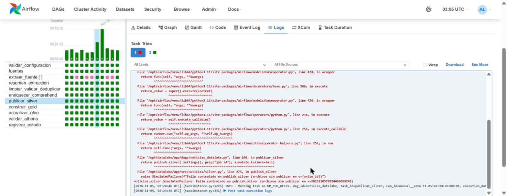

El intento 2 reanuda desde el estado guardado, publica las particiones y deja en el log la fuente, el lote
(`run_id`) y la tarea de cada línea:

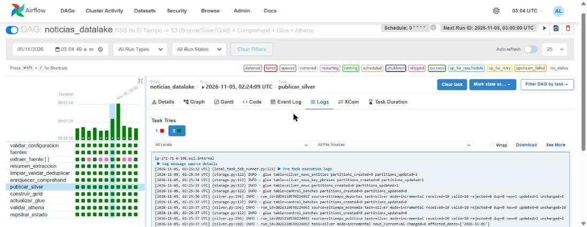

---

## 10. Consultas en Athena

Consultas: [`datalake/sql/02_entregables.sql`](../../sql/02_entregables.sql) · Guía: [`guias/10-consultas-costos.md`](../../docs/guias/10-consultas-costos.md)

### 10.1 Noticias por fecha y sección
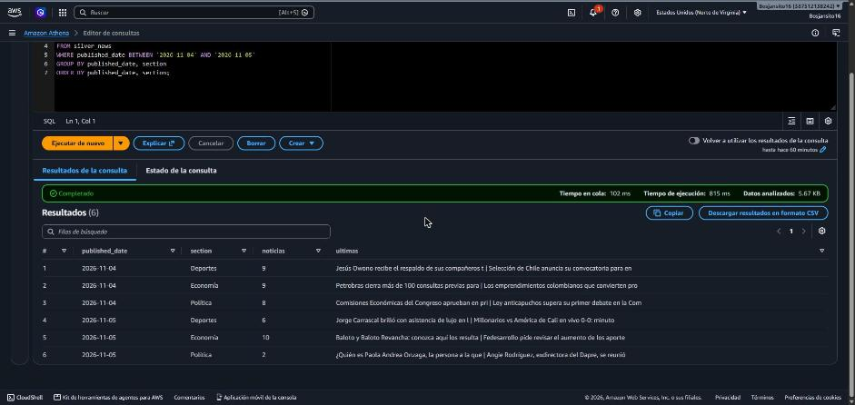

### 10.2 Top 10 organizaciones
Cuenta noticias **distintas** por organización, no menciones:

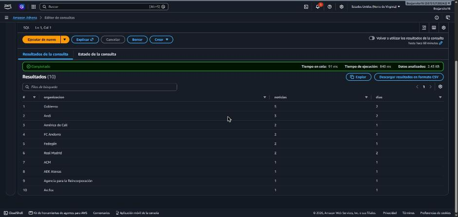

### 10.3 Presencia de una entidad entre días
"Gobierno": 4 de 26 noticias el 2026-11-04 (15,4 %) y 1 de 18 el 2026-11-05 (5,6 %), una variación de −3.

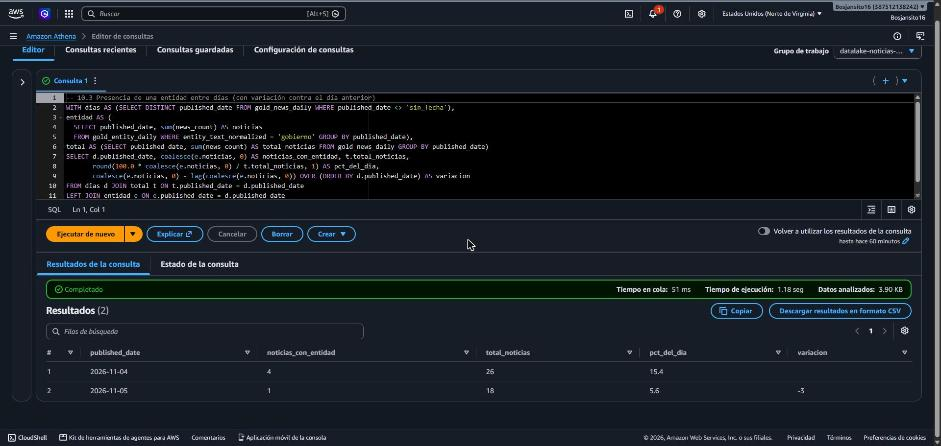

### 10.4 Frases clave por sección
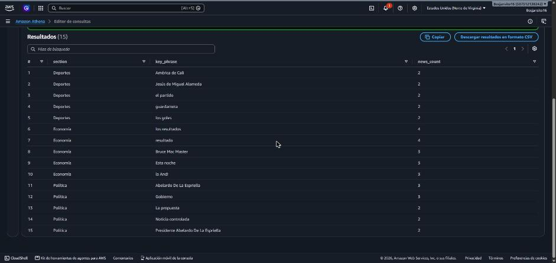

> Las frases genéricas ("los resultados", "resultado") muestran otra limitación de Comprehend: no filtra
> palabras vacías ni frases sin contenido. "Noticia controlada" viene de los ítems de la copia controlada,
> que son datos de prueba válidos.

### 10.5 Conciliación Gold vs Silver
Las 7 combinaciones de fecha y sección tienen diferencia 0 (total 46 = noticias vigentes de Silver):

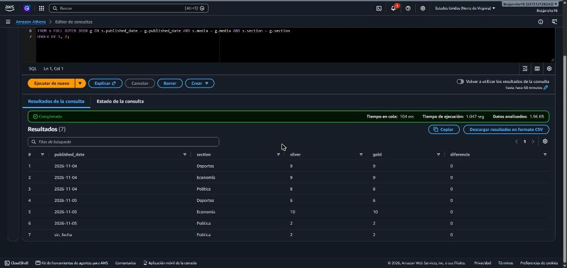

### 10.6 y 10.7 Bytes escaneados con y sin filtro de partición
Es la misma consulta (frases clave por sección con JOIN a noticias); solo cambia el filtro `published_date`:

| Consulta | Bytes escaneados |
|---|---|
| Con filtro de partición (`published_date = '2026-11-05'`) | **0,54 KB** |
| Sin filtro de partición | **1,51 KB** (~2,8×) |

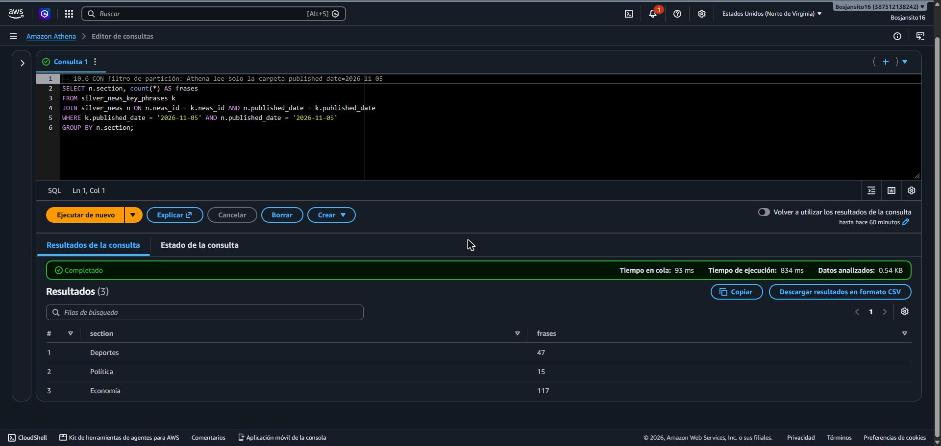

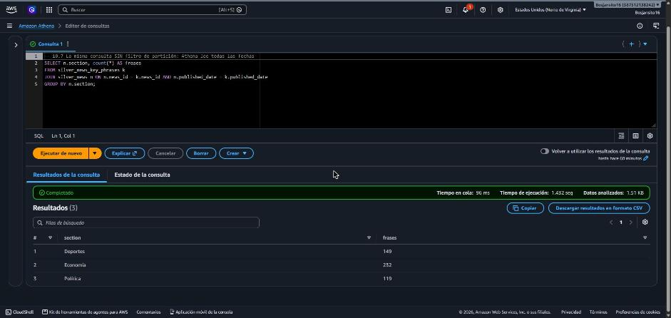

Con el filtro, Athena solo lista y lee la carpeta de esa fecha (*partition pruning*). La diferencia crece con
cada día de datos: sin filtro, el costo aumenta linealmente con el historial. Con filtro, se mantiene en el
tamaño de un día.

---

## 11. Escenarios de calidad, incrementalidad y recuperación

Cada escenario es una ejecución del DAG en Airflow. Los registros de cada uno, con el estado de las tareas,
los conteos por lote y el resultado de las validaciones, están en [`datalake/evidencias/09-escenarios/`](../09-escenarios/).
**En todos, las validaciones finales con Athena dieron 0**: sin ids duplicados, sin entidades o frases
huérfanas y sin descuadre entre Gold y Silver.

| # | Escenario | Qué se hizo | Resultado | Evidencia | Estado |
|---|---|---|---|---|---|
| 11.1 | Carga inicial | Primera extracción de las 3 fuentes, Silver, Gold y Athena | 30 noticias. Bronze, Silver y Gold consultables | Secciones 6–8 | ✅ |
| 11.2 | Registros defectuosos | Copia controlada `defectuosos` de Política (lote `20261105T015607Z`) | 16 recibidos → 3 rechazados (`missing_title`, `missing_link`, `invalid_link`) en cuarentena con `bronze_key`, 1 repetido en el lote, 2 nuevas en `sin_fecha` | [log](../09-escenarios/02-registros-defectuosos.log), captura abajo | ✅ |
| 11.3 | Repetición de un lote exitoso | Reprocesar `20261105T020000Z` (`bronze_run_id`) | 30 recibidos → **30 sin cambios**, 0 cambios, **0 llamadas a Comprehend**, 45 noticias antes y después | [log](../09-escenarios/03-repeticion-lote.log) | ✅ |
| 11.4 | Nuevo lote incremental | Ejecución programada (lote `20261105T000000Z`) | 30 recibidos → **10 nuevas**, 20 sin cambios. Comprehend analizó **solo las 10 nuevas** (2 llamadas). Solo se reescribió la fecha afectada | [log](../09-escenarios/04-nuevo-lote-incremental.log) | ✅ |
| 11.5 | Noticia con contenido modificado | Copia controlada `modificado` del último lote de Política | 2 actualizadas: la de **texto** modificado se volvió a enriquecer (1 analizada); a la de solo **fecha** cambiada se le conservó el análisis, sin llamar a Comprehend. Versión vigente = `version` más alta | [log](../09-escenarios/05-contenido-modificado.log), captura abajo | ✅ |
| 11.6a | Fallo controlado y reejecución | `simular_fallo=true`: `publicar_silver` falla en el intento 1 **después** de escribir `v=…022446…` y **antes** de publicar en Glue | Airflow reintentó y el intento 2 publicó `v=…022533…`. La carpeta del intento fallido quedó huérfana y Glue nunca apuntó a ella: sin duplicados ni datos parciales | [log](../09-escenarios/06a-fallo-controlado-reintento.log) · [Airflow](../09-escenarios/06a-logs-airflow-publicar-silver.log) · [S3 vs Glue](../09-escenarios/06a-s3-version-huerfana-vs-glue.txt) | ✅ |
| 11.6b | Fuente no disponible | `fuente_caida=eltiempo_deportes` (URL que responde 404) | 3 intentos con espera creciente. Fuente registrada como `http_error / HTTP 404`. Ejecución **partial**, no "sin noticias". Las otras 2 fuentes se procesaron | [log](../09-escenarios/06b-fuente-no-disponible.log) · [Airflow](../09-escenarios/06b-logs-airflow-extraer-fuente.log) | ✅ |
| 11.7 | Reprocesamiento desde Bronze | `rebuild=true` | Silver y Gold reconstruidos desde **todos** los lotes de Bronze, sin consultar los RSS. 46 noticias, **46 desde la caché, 0 llamadas a Comprehend** | [log](../09-escenarios/07b-reprocesamiento-bronze-corregido.log) | ✅ |
| 11.8 | Nueva partición | Las noticias sin fecha válida del lote defectuoso crearon `published_date=sin_fecha` | `actualizar_glue` la registró con `BatchCreatePartition` y quedó consultable en Athena | capturas abajo | ✅ |

**11.2 Cuarentena:** motivo de cada rechazo y ruta del archivo original en Bronze.

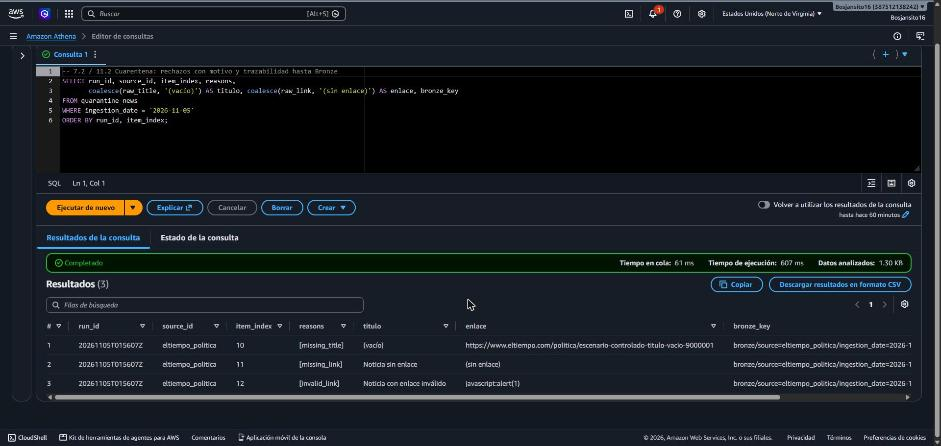

**11.5 Versiones:** noticias con más de una versión. La vigente es la de versión más alta y conserva su
enriquecimiento.

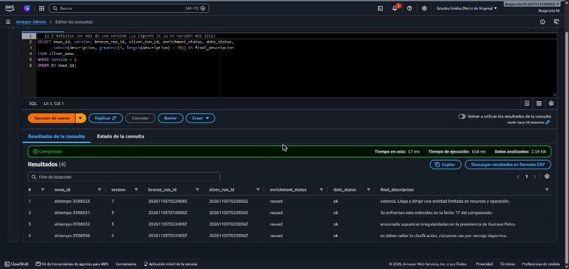

**11.8 Nueva partición `sin_fecha`:** registrada en Glue y consultable en Athena.

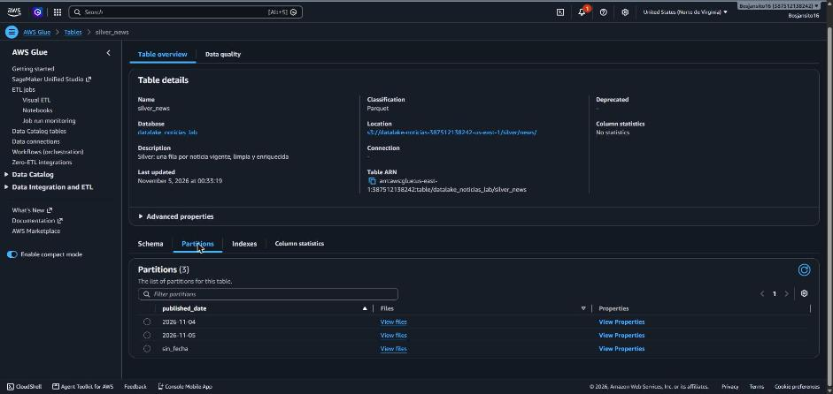

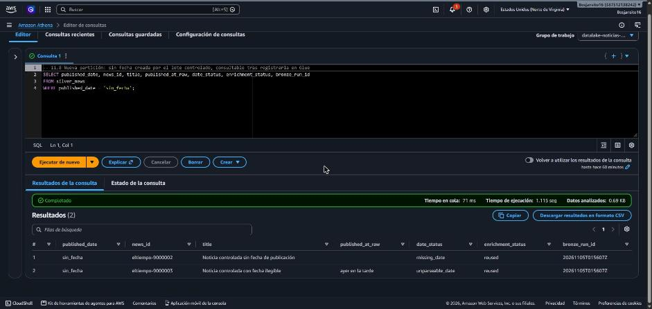

### Error encontrado por las validaciones (y corregido)

El primer `rebuild` ([log](../09-escenarios/07-reprocesamiento-bronze.log)) dejó 2
noticias sin `enrichment_status`, sin entidades ni frases:


**Causa.** En una reconstrucción, una versión posterior de una noticia con el mismo texto heredaba el
enriquecimiento de la versión anterior. Esa versión todavía no estaba enriquecida, porque Comprehend se
ejecuta después de preparar todo.

**Corrección.**
1. Solo se hereda el enriquecimiento si la versión anterior ya estaba publicada.
2. Se agregó la regla `noticias_sin_enriquecimiento` a las validaciones. Detectó el problema
   ([log](../09-escenarios/07a-validacion-detecta-noticias-sin-enriquecer.log)).
3. Se repitió el `rebuild` (46 desde la caché y 0 noticias sin enriquecer).

### Recibidos vs. noticias únicas por lote

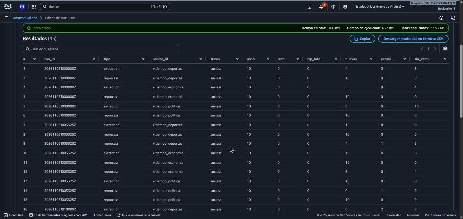

Cada feed entrega 10 ítems por hora, pero la mayoría se repite entre lotes (`sin_camb`). Las noticias únicas
publicadas = recibidos − rechazados − repetidos en el lote − repetidas de lotes anteriores. Las filas
`reprocess` son el registro adicional de cada reprocesamiento: el registro original del lote no se modifica.

### Limitación observada de las copias controladas

La copia `defectuosos` partió del lote de las 00:33. Una noticia que el medio había editado después volvió
temporalmente al texto antiguo (1 `updated`), porque la copia tiene un `run_id` más reciente. La siguiente
extracción real la actualizó de nuevo. Por eso la copia `modificado` se hizo del lote más reciente.

---

## 12. Eliminación de recursos

Guía: [`guias/10-consultas-costos.md`](../../docs/guias/10-consultas-costos.md#eliminación)

### 12.1 `terraform destroy` de la instancia EC2
La EC2 de Airflow (`t3.medium`, ~USD 0,047/h) era el único recurso con costo por hora. Se eliminó con un
destroy dirigido, revisando primero el plan:

```bash
terraform plan -destroy -target=aws_instance.airflow -out=destroy-ec2.tfplan
terraform apply destroy-ec2.tfplan
```

Terraform: [`plan`](../12-eliminacion/01-terraform-plan-destroy-ec2.txt) /
[`apply`](../12-eliminacion/02-terraform-destroy-ec2.txt)

```text
Plan: 0 to add, 0 to change, 1 to destroy.
aws_instance.airflow: Destroying... [id=i-0a27767206dc5cd38]
aws_instance.airflow: Destruction complete after 21s
Apply complete! Resources: 0 added, 0 changed, 1 destroyed.
```

La instancia queda en estado **Terminada** en la consola de EC2:

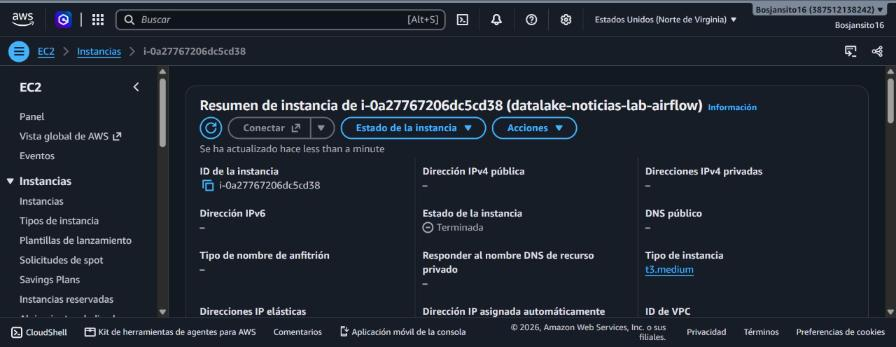

### 12.2 Recursos que se conservan
El bucket, el catálogo de Glue, el workgroup de Athena, el rol IAM y el security group se conservan para la parte
de Data Warehouse, que usa las tablas Gold como fuente. Ninguno cobra por hora: solo el almacenamiento en S3
(unos KB) y las consultas que se ejecuten. Lista completa en
[`03-terraform-state-restante.txt`](../12-eliminacion/03-terraform-state-restante.txt).

Al terminar el taller completo, se elimina todo con `terraform destroy` (el bucket tiene `force_destroy = true`,
así que se vacía y se borra) y se verifica que `terraform state list` quede vacío.
