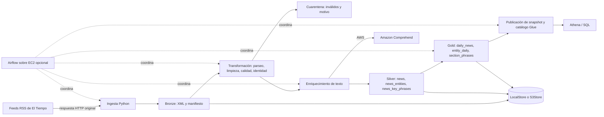

# Arquitectura y recorrido de aprendizaje

## Diagrama lógico

En AWS, todas las capas residen en un único bucket S3, separadas por prefijos; localmente, el store corresponde a un directorio. La figura representa el contrato del proyecto, no una captura de recursos desplegados. Airflow y Comprehend se usan solo en la ruta AWS desplegada; el modo local puede tener enriquecimiento deshabilitado explícitamente y debe identificar ese estado, nunca simular respuestas del servicio.

## Componentes y límites

1. **Fuentes:** tres secciones RSS configuradas. Se ingiere solo el contenido de RSS, no páginas enlazadas.
2. **Bronze:** bytes originales válidos, referencia a URL/fuente, estado HTTP, hora UTC, hash y ubicación. Un lote persistido permite rehacer las etapas posteriores sin depender de que el origen siga disponible.
3. **Transformación:** interpreta XML, limpia HTML, normaliza fechas, comprueba campos requeridos, deduplica y separa inválidos en cuarentena trazable.
4. **Enriquecimiento:** personas, organizaciones, lugares y frases clave sobre título y descripción disponibles. El idioma, hash de texto, fecha/estado y confianza devuelta acompañan el resultado; el hash permite reconocer texto sin cambios.
5. **Silver:** noticias vigentes y relaciones de entidades/frases en Parquet.
6. **Gold:** agregaciones para preguntas analíticas; cada presencia cuenta noticias distintas y no repeticiones de una mención dentro del texto.
7. **Catálogo/consulta:** Glue describe esquema, ubicación y partición `publication_date`; Athena consulta Parquet y escribe resultados de consulta en la ubicación asignada.
8. **Orquestación opcional:** DAG de Airflow ejecuta dependencias, registra estado y permite reproceso por lote. Una caída de feed debe ser distinguible de una respuesta válida vacía.

## Publicación consistente

Silver y Gold se construyen como snapshots inmutables separados por ejecución. `validate` termina las escrituras y comprobaciones y publica una referencia (`_control/current.json`) de forma atómica; el orquestador actualiza después las ubicaciones de Glue y registra particiones explícitamente. Una ejecución interrumpida antes del commit deja objetos de snapshot sin publicar y el snapshot anterior sigue vigente. Durante la actualización secuencial de las seis tablas Glue, no existe una transacción multitabla: una consulta concurrente puede observar temporalmente tablas de ejecuciones diferentes. Ejecute consultas de validación después de completar el paso de catálogo. Crear un prefijo por sí solo no registra una partición.

## Lectura local y AWS

`LocalStore` ofrece el mismo contrato lógico de lectura/escritura que `S3Store`. Local es adecuado para aprender la transformación y persistencia, pero no prueba IAM, Glue, Athena, Comprehend ni Airflow remoto. El despliegue AWS utiliza S3, roles IAM, Glue, Athena, Comprehend y, de forma opcional, EC2 con Airflow. La guía Terraform separa infraestructura declarativa y artefacto de despliegue: primero se publica el paquete requerido en el bucket y solo entonces se habilita la instancia.

## Decisiones de interpretación

- **Fecha ausente o no interpretable:** la fecha de publicación analítica usa `1970-01-01` como partición centinela; se conserva el valor original y el estado de fecha para no confundirlo con una fecha observada válida.
- **Identidad:** hash SHA-256 de medio y enlace HTTP(S) canónico; el canonicalizador elimina fragmento y parámetros de tracking y ordena la query. GUID se conserva como dato, pero no participa en la clave. Si la misma URL aparece en feeds distintos del mismo medio, se conserva la sección/fuente ordenada primero por `(section, source)`; dentro de ese feed gana la fila con fecha válida más reciente y, en empate, hash mayor de contenido. Cambios de enlace pueden producir una identidad nueva; no se resuelven alias.
- **Sin texto procesable:** vacío, idioma distinto de `es`/`en` o texto de más de 5000 bytes UTF-8 queda con estado explícito (`skipped_empty`, `skipped_language`, `skipped_too_long`). En local, `skipped_disabled` significa enriquecimiento deshabilitado; no se atribuyen entidades inventadas.
- **Historia:** los snapshots conservan material publicado por ejecución; el conjunto vigente es el que apuntan el manifiesto de publicación y el catálogo. Las métricas deben consultar solo el conjunto vigente.
