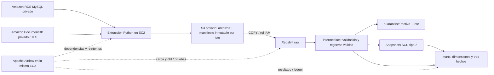

# Arquitectura y decisiones de migración

## Origen localizado

Se encontró el proyecto previo en `/home/emanuel/Universidad/Sexto/Ingenieria de Datos/DE-DW`. Se tomaron como referencia `src/ecommerce_dw/sources`, `src/dbt` y `docs/data_model.md`. No se modificó su repositorio, su `.env`, su archivo DuckDB ni sus servicios. La implementación de destino vive exclusivamente en `datawarehouse/` de este repositorio; el Data Lake existente mantiene su carpeta y evidencias históricas.

## Reglas del proyecto previo que no cambian

- `fct_sales` tiene una fila por **línea de pedido**, no por pedido. Sus medidas son `quantity` y `subtotal` de `order_items`; no debe sumarse el total de un pedido por cada línea.
- `fct_reviews` tiene una fila por reseña; `fct_navigation_events`, una por evento. Son hechos separados con dimensiones conformadas: unir indiscriminadamente reseñas/eventos a ventas multiplicaría medidas.
- Clientes y productos conservan historia SCD2. La llave natural identifica al registro; la llave sustituta distingue su versión. `updated_at` y los intervalos de validez determinan apertura y cierre; repetir el mismo lote no debe abrir una nueva versión.
- Fechas de negocio de reseñas y eventos se interpretan en `America/Bogota`; los timestamps de origen documental se almacenan en UTC. Se conservan los seeds de municipios y festivos colombianos.
- Registros defectuosos son una entrada deliberada de la práctica: pasan a cuarentena con motivo y lote, no se ocultan ni deben impedir por sí solos las pruebas de las capas válidas.
- Un lote incremental reproducible del generador usa el día `2026-01-01 + (N-1)` e identificadores estables. La extracción conserva las dimensiones necesarias y selecciona los hechos del lote según los parámetros documentados por el CLI; no se confunde el identificador técnico del lote S3 con una columna inexistente en las fuentes originales.

## Cambios respecto de la ejecución local

| Local DE-DW | AWS | Mejora y diferencia que se debe comprobar |
|---|---|---|
| MySQL Docker | RDS MySQL | Fuente administrada y cifrada, endpoint privado; TLS con CA verificada y conectividad restringida a EC2. |
| MongoDB Docker | DocumentDB | Base documental administrada; no es un reemplazo idéntico. Requiere TLS con CA AWS, `retryWrites=false` y revisar compatibilidad de validadores/operadores. |
| Extracciones locales | S3 | Archivos por fuente/entidad/lote y manifiesto con metadatos permiten recuperar sin consultar de nuevo las fuentes. Versionado no sustituye protección de escritura ni verificación del manifiesto. |
| DuckDB local | Redshift Serverless | Almacén analítico independiente del proceso Python, ingestión COPY con rol IAM y ejecución SQL distribuida; tipos, JSON, fechas y funciones se adaptan al dialecto Redshift. |
| Airflow/dbt en Docker local | Airflow y dbt en una EC2 | Un punto de orquestación con logs y tareas explícitas; dbt envía SQL a Redshift, no transforma sobre la memoria/disco local. |
| Archivos de estado locales | Manifiesto S3 + ledger Redshift | El manifiesto identifica la entrada; el ledger distingue carga de éxito tras pruebas. No avanzar el resultado exitoso antes de terminar snapshots, modelos y pruebas. |

## Seguridad y ciclo de vida

La infraestructura nueva se identifica por su propio estado Terraform y etiquetas. No se importan ni eliminan recursos externos. Las bases y Redshift no se publican; la EC2 no abre SSH ni Airflow a Internet, y el acceso a la UI es mediante túnel SSM. Los secretos se obtienen en tiempo de ejecución y el estado Terraform debe considerarse confidencial.

La identidad actual se comprueba antes de crear servicios facturables, sin captura ni confirmación. La primera pausa de evidencia corresponde a S3/Terraform (1.1). Para cada servicio se pide captura y confirmación; posteriormente se eliminan los recursos propios ya innecesarios. Si un componente es dependencia de una demostración posterior, se exportan sus datos y se planifica su reconstrucción, o se informa claramente la retención y su costo. No se elimina ningún recurso antes de la confirmación de la captura. Véanse [operación](guia-operacion.md), [costos](costos.md) y [evidencias](../evidencias/docEVIDENCIA/EVIDENCIAS.md).
