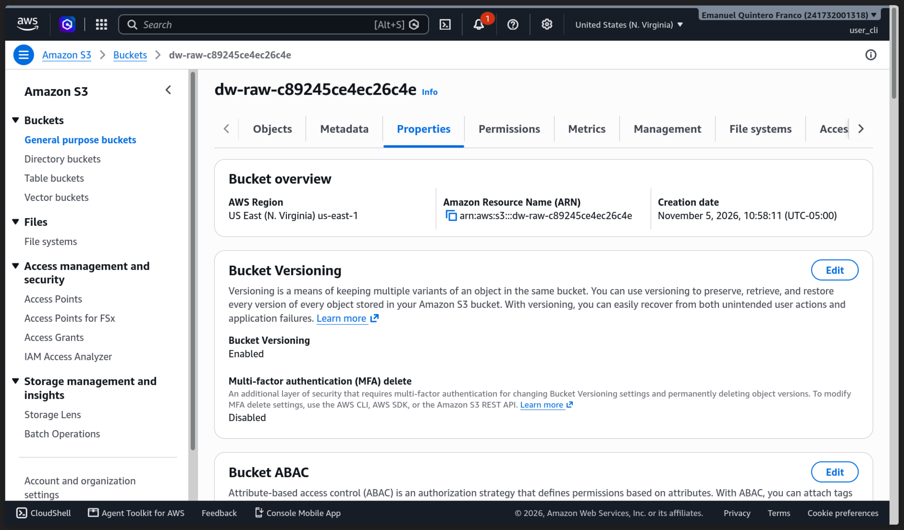
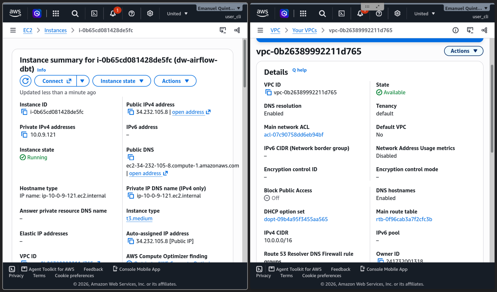
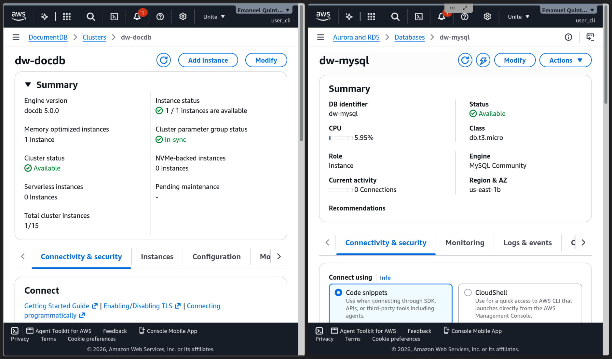
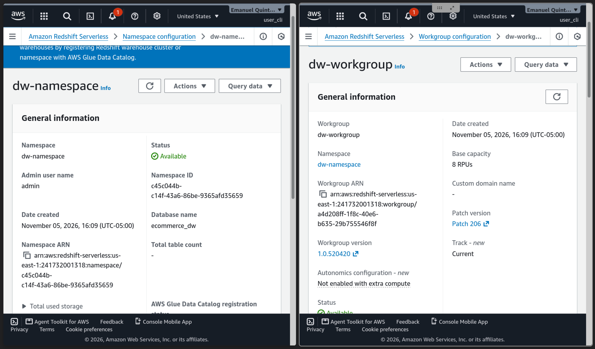
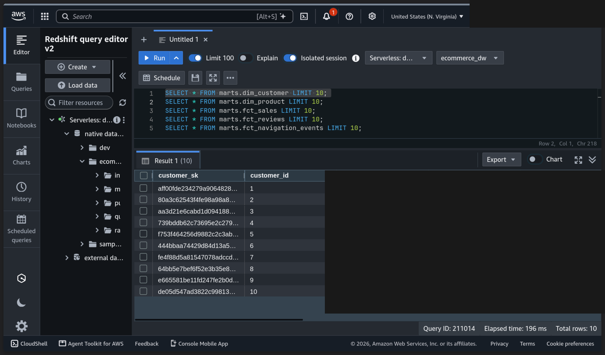
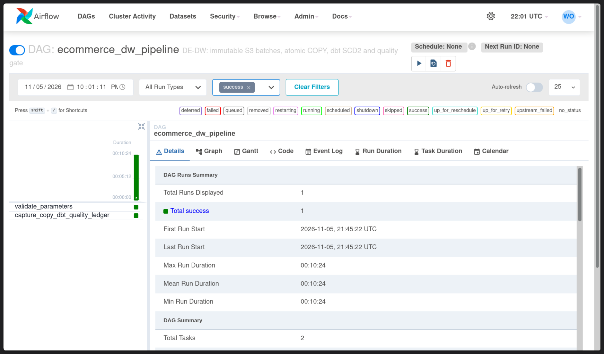

# Evidencias – Data Warehouse en AWS

## Estado y cronología

- Se capturaron S3, EC2/VPC, RDS/DocumentDB y Redshift durante su despliegue.
- El lote inicial fue reprocesado desde S3: Airflow terminó correctamente y dbt registró 151 pruebas aprobadas. Los conteos y rechazos observados están en [lote-0-calidad.txt](../07-airflow/lote-0-calidad.txt).
- Por decisión del usuario se cerró la práctica antes de ejecutar los escenarios de repetición, incrementalidad, SCD2, fallo controlado y conciliación final; permanecen sin demostrar.
- En la comprobación de cierre de `us-east-1` no se listaron instancias RDS/DocumentDB, EC2, workgroups o namespaces Redshift, buckets ni volúmenes. Permanecían una VPC, tres subredes privadas y grupos de seguridad, parámetros y subredes de bases. Este registro no sustituye un inventario actual ni acredita ausencia de cargos en otras regiones.

## 1. S3 y Terraform

Terraform convierte la configuración de infraestructura en un plan revisable y un estado identificable. S3 conserva exportaciones y manifiestos por lote, separando almacenamiento de las fuentes y permitiendo reprocesar sin volver a consultarlas. Privacidad, cifrado y versionado mejoran el control frente a archivos locales, pero las versiones también pueden generar costo.

La captura muestra las propiedades del bucket y el versionado habilitado en ese momento. No muestra por sí sola la configuración de cifrado, acceso público o TLS.

Usar únicamente la imagen 1.1 para Terraform y configuración S3; no pedir imágenes separadas de Permisos/Propiedades. Las consultas AWS de lectura pueden mostrar bloqueo público, cifrado, versionado y política TLS. Después guardar en texto el listado real `raw/<fuente>/<entidad>/batch_id=<id>/` y manifiestos con fecha, lote, conteo y checksum: no requieren otra imagen. Pausar y confirmar S3 antes de seguir o retirar el bucket; si lo requiere la siguiente fase, exportar datos y reconstruirlo o registrar retención y costo.

## 2. Red e IAM

La VPC aísla las bases y Redshift en subredes privadas; los grupos de seguridad permiten solo las conexiones necesarias desde EC2. IAM autoriza a EC2 y COPY sin claves estáticas de aplicación. Esto reduce exposición y privilegios frente a puertos locales publicados.

La captura histórica conjunta muestra la VPC disponible y la instancia EC2 en ejecución. No acredita por sí sola las reglas de los grupos de seguridad ni los permisos IAM.

La captura histórica 2.1/3.1 está enlazada arriba. Por decisión del usuario IAM no requiere captura ni confirmación independiente. El rol COPY se crea con warehouse; conservar sus políticas y las ampliaciones de permisos de secretos como soporte textual, sin mostrar valores.

La comprobación EC2 3.1 comparte la captura histórica 2.1 enlazada en la matriz.

## 3. EC2 y Airflow

EC2 ejecuta Airflow y dbt juntos; Airflow ordena validación, extracción, carga, snapshots, modelos, pruebas y resultado. La mejora es poder identificar lote/tarea fallidos y reintentar de forma acotada sin intervención entre etapas. Las transformaciones SQL se ejecutan en Redshift, no en DuckDB ni en EC2.

Usar 3.1 para EC2 y su seguridad. Acceder mediante Systems Manager y túnel al puerto local de Airflow según [guía operativa](../../docs/guia-operacion.md). La UI del DAG se muestra en 7.1; conservar también el resumen real de dbt como soporte textual. Confirmar EC2 antes de continuar; confirmar Airflow cuando exista evidencia real de su funcionamiento. Terminar EC2 cuando deje de ser necesaria; detenerla no elimina el costo EBS.

## 4. RDS MySQL

RDS administra la fuente relacional y su almacenamiento cifrado. Mantiene las tablas clientes, productos, pedidos y líneas, conservando las reglas de negocio del origen y eliminando la dependencia de un contenedor MySQL local.

Reunir en 4.1 estado **Available**, motor MySQL, endpoint privado, cifrado y conexión TLS desde EC2. Guardar tablas/conteos en texto después de seed, sin imagen por tabla ni contraseñas de Secrets Manager; no exigir datos sembrados antes de confirmar disponibilidad. Esperar confirmación de RDS antes de continuar o eliminar recursos propios; el pipeline completo necesita esta fuente o una reconstrucción reproducible.

La captura conjunta de RDS y DocumentDB se muestra una sola vez a continuación; refleja disponibilidad, no la conexión TLS ni el cifrado.

## 5. DocumentDB

DocumentDB administra reseñas y eventos documentales. Conserva documentos anidados pero no equivale a MongoDB: se utiliza CA verificada, TLS y `retryWrites=false`, y las reglas de calidad se comprueban en dbt. La mejora es una fuente administrada privada, sin asumir compatibilidad total de validadores u operadores MongoDB.

La misma captura de la fase 4 muestra el clúster DocumentDB y su instancia disponibles; no se duplica aquí.

Reunir en 5.1 cluster/instancia disponibles, cifrado, endpoint privado y conexión TLS válida desde EC2. Guardar colecciones/conteos después de seed y ajustes de compatibilidad observados en texto, sin información sensible ni imagen adicional. Confirmar DocumentDB antes de continuar; los volúmenes/backups pueden seguir facturándose incluso sin una instancia activa.

## 6. Redshift y dbt

Redshift sustituye DuckDB como almacén analítico; COPY ingiere exportaciones S3 mediante rol IAM. dbt adapta SQL al motor y separa raw, registros evaluados, cuarentena y marts. Snapshots conservan versiones SCD2 de clientes/productos y las pruebas verifican llaves y reglas.

La captura muestra el namespace y el workgroup de Redshift Serverless disponibles en ese momento. No demuestra por sí sola COPY ni resultados de consultas.

El editor de Redshift muestra diez filas de `marts.dim_customer` y consultas escritas para otras tablas; la captura solo presenta el resultado de la primera. Se han cubierto de manera irreversible las columnas con nombres, correos y teléfonos, así como el nombre de cuenta visible en la consola.

Usar 6.1 para disponibilidad/configuración de Redshift y confirmar el servicio antes de continuar. Tras ejecutar el pipeline, guardar COPY/ledger, tablas por capa, SQL y resultados completos como texto; el soporte textual de 7.1 registra un resumen de dbt. No exigir una imagen para COPY, otra para capas y otra para dbt. Confirmar dbt con su evidencia y Airflow con la imagen correspondiente, sin duplicarla. Almacenamiento, snapshots y secretos pueden persistir al eliminar cómputo.

## 7. Escenarios de calidad y demostración

La interfaz de Airflow muestra el DAG y una ejecución exitosa. No muestra el resumen de dbt; el [soporte textual del lote 0](../07-airflow/lote-0-calidad.txt) registra conteos, rechazos, estado del ledger y resultado de pruebas dbt. La captura por sí sola no confirma todos los escenarios.

Guardar SQL/comandos y salida completa antes/después, lote técnico, fecha, estado de ledger y resultado para E1–E9. **No se exigen imágenes adicionales**: resultados reproducibles en `.sql`, `.json`, `.txt` o `.log` bastan para estos escenarios. Cada escenario tiene su propia pausa y confirmación de evidencia:

- Inicial: conteos de dimensiones y tres hechos.
- Calidad: registros concretos de cuarentena con motivo/lote y comparación válidos+rechazos.
- Repetición: mismos hechos, medidas e historial, sin duplicados.
- Incremental: nuevo lote fuente incorporado a ventas, reseñas y navegación.
- SCD2: cliente/producto antes y después, una versión previa cerrada y una vigente.
- Recuperación (E6/E7): fallo deliberado después de COPY y ledger no exitoso; guardar salida y **parar para confirmar E6 antes del replay**. Después guardar replay solo desde S3, resultado exitoso y comparación sin pérdida/duplicación; confirmar E7.
- Conciliación: indicador agregado de líneas válidas y `fct_sales` iguales, con SQL reproducible.
- Demostración (E9): nuevo lote completo desde fuentes hasta marts, identificando ejecución Airflow/CLI y explicación del ledger. Puede compartir resultados con E4/E5 si cumplen todos sus requisitos; no repetir un lote solo para producir otra captura.

La mejora es demostrar recuperación e integridad, no inferirlas por tener un DAG verde. No marcar capturada una fila cuyo comportamiento aún no haya sido ejecutado.
